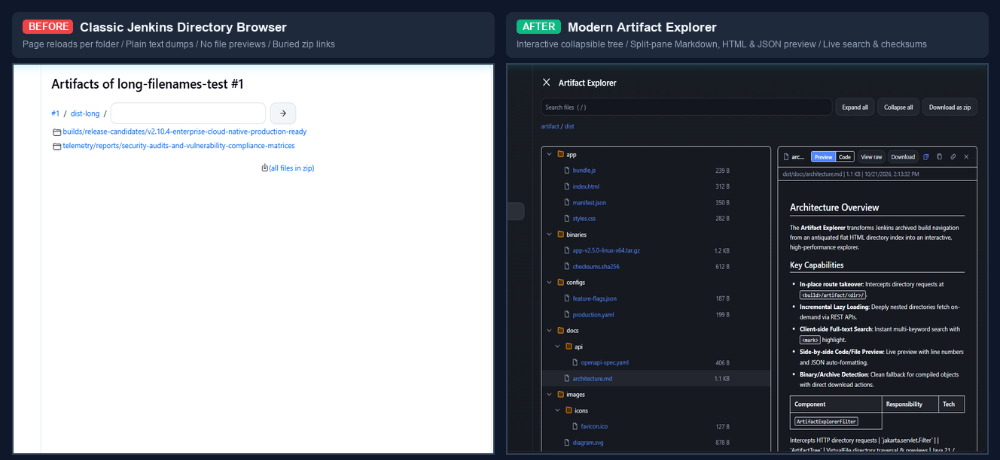

# Artifact Explorer Jenkins Plugin

[](https://github.com/jenkinsci/artifact-explorer-plugin/actions/workflows/ci.yml)
[](https://github.com/jenkinsci/artifact-explorer-plugin/releases)
[](https://opensource.org/licenses/MIT)
[](https://spotbugs.github.io/)

A modern, high-performance interactive artifact browser for Jenkins. Replaces classic directory indexes with an interactive collapsible tree, live split-pane file previews, instant search, and sleek overview cards.

---

## Classic Jenkins vs. Artifact Explorer



| Capability | Classic Jenkins | Artifact Explorer |
| :--- | :--- | :--- |
| **Directory Navigation** | Full-page browser reload per folder click | Instant, collapsible tree with keyboard navigation and lazy-loading |
| **File Inspection** | Monochrome unformatted text dumps or local download | Split-pane live previews for Markdown, HTML (sandboxed), JSON, YAML, CSV, images |
| **Search & Discovery** | None (manual browser `Ctrl+F` on single pages) | Instant client-side search across all artifacts with `<mark>` highlight |
| **Build Summaries** | Monolithic flat table displacing logs and stage views | Compact overview card (215px) with instant **Tree / Flat** view toggle |
| **File Operations** | Download only (zip link buried at bottom) | 1-click SHA-256 verifier, subfolder zip download, copy contents, deep link URLs |
| **Pipeline Changes** | Standard `archiveArtifacts` | **Zero changes required** (works automatically with existing pipelines) |

---

## Key Features

### 1. Interactive Tree & Split-Pane Previews
Replaces the directory browser at `<build>/artifact/` with an interactive split-pane interface:


- **Markdown (`.md`)**: Formatted headings, tables, code blocks, and blockquotes with a `[ Preview | Code ]` toggle.
- **HTML Artifacts (`.html`)**: Interactive bundled web apps and reports rendered in a secure sandboxed frame.
- **Config & Code Coloration**: Zero-dependency syntax highlighting for `.json`, `.yaml`, `.xml`, `.properties`, `.env`, and shell scripts. Automatically pretty-prints JSON.
- **Data & Graphics**: Formatted tables for `.csv` and `.tsv`; responsive preview for `.png`, `.jpg`, `.svg`, and `.gif`.
- **Extension Filter Pills**: One-click pills (`[ All (17) ]`, `[ .json (4) ]`, `[ .log (1) ]`) to instantly isolate file types.
- **Direct Subfolder Zips**: Download any directory as a compressed `.zip` archive on hover.

---

### 2. Modernized Build & Job Overview Cards
Replaces the flat file list on Job and Build overview pages with a compact, card-framed interactive widget:

| Interactive Tree View | Redesigned Flat View |
| :--- | :--- |
|  |  |

- **Segmented View Switcher**: Instantly toggle between nested **`[ Tree ]`** hierarchy and clean **`[ Flat ]`** file listing.
- **Live Search & Extension Pills**: Filter build artifacts in real time without leaving the build overview.
- **Direct Explorer Link**: Jump directly into the full Artifact Explorer with a single click.

---

### 3. SHA-256 Checksum Verifier & Provenance

| Keyboard Shortcuts Dialog (`?`) | Cryptographic SHA-256 Verifier (`s`) |
| :--- | :--- |
|  |  |

- **On-Demand SHA-256 Hashing**: Calculates cryptographic hash on the controller without downloading files to the browser.
- **Manifest Verification**: Automatically matches hashes against build manifests (`*.sha256`) and displays a green `Verified Match` or red `Checksum Mismatch` badge.
- **Provenance Dashboard**: Modern hero card on fingerprint inspection pages with one-click MD5 copy and build lineage.

---

### 4. Keyboard Navigation (Vim Ergonomics)

Press **`?`** anywhere in the explorer to view the shortcut cheatsheet:

| Key | Action |
| :--- | :--- |
| **`/`** | Focus and select the search filter |
| **`j` / `k`** | Navigate down / up through visible tree rows |
| **`o` / `Enter`** | Expand / collapse directory or open file preview |
| **`c`** | Copy file contents to clipboard |
| **`l`** | Copy shareable deep link URL (`#path/to/file`) |
| **`d`** | Download the active file |
| **`s`** | Calculate SHA-256 checksum |
| **`Esc`** | Close dialog, clear search, or close preview |

---

## Getting Started

### 1. Installation
Install **Artifact Explorer** from **Manage Jenkins -> Plugins -> Available Plugins**. No Jenkins restart is required.

### 2. Pipeline Usage
No changes are necessary! Any existing pipeline using `archiveArtifacts` works out of the box:

```groovy
pipeline {
    agent any
    stages {
        stage('Build & Archive') {
            steps {
                sh 'npm run build'
                // Artifact Explorer automatically provides rich browsing for these files:
                archiveArtifacts artifacts: 'dist/**', fingerprint: true
            }
        }
    }
}
```

---

## Configuration & JCasC

Configure globally under **Manage Jenkins -> System -> Artifact Explorer**, or declaratively via Jenkins Configuration as Code (JCasC):

```yaml
unclassified:
  artifactExplorer:
    replaceClassicBrowser: true
    maxEntries: 5000
```

- **Escape Hatch**: To view the classic directory listing for any build at any time without disabling the plugin, append `?legacy=1` to the URL.
- **Resource Root URL**: Fully compatible with Jenkins Resource Root domains for isolated artifact serving.

---

## Architecture & Security

- **In-Place Servlet Filter**: Intercepts interactive browser requests at `<build>/artifact/<dir>/` while leaving automated file downloads, `*zip*`, and CLI requests untouched.
- **Strict Access Control**: Enforces `Run.ARTIFACTS` (falling back to `Item.READ`).
- **Path Traversal & Symlink Protection**: Strict path sanitization prevents directory traversal; realpath checks prevent symlink escapes outside the artifact root.
- **Zero Inline Code & CSP Safe**: Written in vanilla ES2022 and native CSS variables without external frameworks, adhering to Jenkins Content Security Policy (CSP).

---

## Contributing & License

Contributions are welcome! Please see [CONTRIBUTING.md](CONTRIBUTING.md) for details.

Licensed under the [MIT License](LICENSE).
